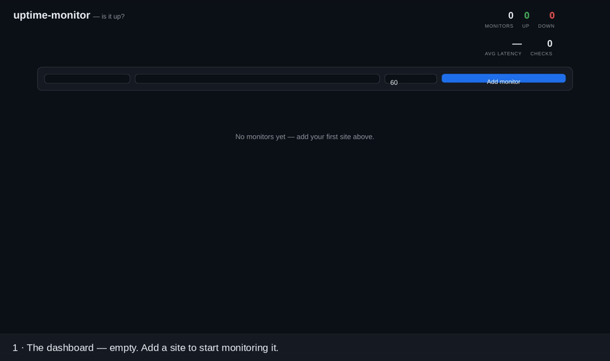
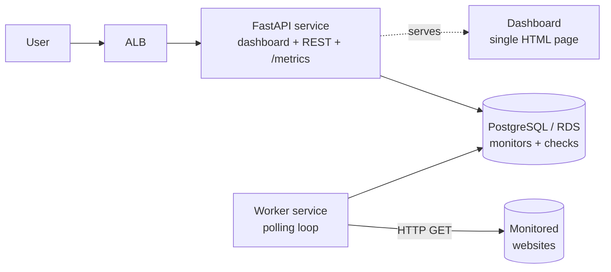

# uptime-monitor

A small uptime monitoring service — a mini-Pingdom. Register the websites
you care about and it checks them on an interval, records status and
latency, and shows a live dashboard: what's **up**, what's **down**,
response times, uptime percentage and per-site history sparklines. It's a
deliberately small but complete software product: a REST API, a background
checker worker, a database, a web UI, tests, containers, CI/CD and
Terraform for AWS.

## Demo



*17-second demo from a live local run — [MP4 version](docs/demo.mp4),
walkthrough in [docs/demo.md](docs/demo.md). The dashboard starts empty;
two monitors are added: a demo website (UP) and a dead address (DOWN).
The demo site is then stopped for real — the dashboard flags it DOWN
within one check interval — and it recovers when the site comes back,
with the outage visible in its history. The recording uses local
stand-in sites so the outage is reproducible on cue; on a normal network
the seed script monitors github.com and tu-dortmund.de the same way.*

## Features

- Add monitors with a per-site check interval (10 s – 1 h)
- Background worker probes due monitors concurrently and stores every check
- Dashboard with live status pills, latency, uptime %, check counts and
  latency sparklines (auto-refreshes every 5 s)
- "Check now" button for an on-demand probe, plus the same via the API
- Fleet stats endpoint and Prometheus `/metrics`
- SQLite by default (zero setup); PostgreSQL when `DATABASE_URL` is set
- One Docker image, two roles: API (default) and worker (command override)

## Architecture



## Project structure

```
.
├── app/
│   ├── main.py          # FastAPI: REST API, stats, metrics, dashboard route
│   ├── worker.py        # polling loop: probes due monitors, stores checks
│   ├── checker.py       # one async HTTP probe -> up/down + latency + error
│   ├── models.py        # Monitor and Check (SQLAlchemy)
│   ├── db.py            # engine/session from DATABASE_URL (SQLite default)
│   └── static/index.html# the dashboard (vanilla JS + inline SVG, no build)
├── scripts/
│   └── run_demo_seed.py # three demo monitors, each checked once
├── tests/               # checker (MockTransport) + API (TestClient)
├── infra/terraform/     # AWS: ECR, ECS Fargate (API + worker), ALB, RDS
├── docker-compose.yml   # db + api + worker
├── Dockerfile           # one image for both roles
└── docs/demo.md         # demo script / recording notes
```

## Local quickstart

### Option A — plain Python (SQLite, zero setup)

```bash
python -m venv .venv && source .venv/bin/activate
pip install -r requirements.txt

uvicorn app.main:app --port 8000          # terminal 1: API + dashboard
python -m app.worker                      # terminal 2: checker worker
python scripts/run_demo_seed.py           # optional: seed 3 monitors

# dashboard -> http://localhost:8000
```

### Option B — Docker Compose (PostgreSQL + API + worker)

```bash
docker compose up --build
python scripts/run_demo_seed.py   # with DATABASE_URL pointing at the compose DB,
                                  # or add monitors from the dashboard instead
```

Run the tests and linter:

```bash
pip install pytest ruff
pytest -q
ruff check app tests scripts
```

## API

| Method | Path | Description |
|---|---|---|
| `GET` | `/health` | Liveness + monitor count |
| `POST` | `/api/monitors` | Create a monitor (`name`, `url`, `interval_seconds` 10–3600) → 201 |
| `GET` | `/api/monitors` | List monitors with last check, uptime %, check count |
| `GET` | `/api/monitors/{id}` | One monitor |
| `DELETE` | `/api/monitors/{id}` | Delete monitor and its checks → 204 |
| `GET` | `/api/monitors/{id}/checks?limit=50` | Check history, newest first |
| `POST` | `/api/monitors/{id}/check` | Run a check immediately and return it |
| `GET` | `/api/stats` | Totals: monitors up/down, checks, average latency |
| `GET` | `/metrics` | Prometheus: `uptime_checks_total{result}`, `uptime_monitors_up` |

## Configuration

| Variable | Default | Meaning |
|---|---|---|
| `DATABASE_URL` | `sqlite:///./uptime.db` | SQLAlchemy URL; set to `postgresql+psycopg2://…` for Postgres |
| `WORKER_TICK_SECONDS` | `5` | How often the worker looks for due monitors |
| `CHECK_TIMEOUT` | `10` | Per-check HTTP timeout in seconds |

## Deploying to AWS

Terraform in `infra/terraform/` provisions: ECR, an ECS Fargate service
for the API behind an ALB, a second Fargate service for the worker, RDS
PostgreSQL 16 (private, reachable only from the tasks), IAM roles and
CloudWatch log groups — all in `eu-central-1` by default.

```bash
cd infra/terraform
terraform init
terraform plan -var db_password='CHANGE_ME'   # supply out-of-band, never commit
terraform apply -var db_password='CHANGE_ME'

# build and push the image (repository URL is a terraform output)
aws ecr get-login-password --region eu-central-1 | \
  docker login --username AWS --password-stdin <ecr_repository_url>
docker build -t <ecr_repository_url>:latest ../..
docker push <ecr_repository_url>:latest
```

The dashboard is then reachable at the `api_url` output.

> **Cost hygiene:** an ALB, two Fargate services and an RDS instance bill
> by the hour even when idle. This is a portfolio deployment — run
> `terraform destroy` as soon as you have finished evaluating it.

## Tech stack

Python 3.12 · FastAPI · SQLAlchemy 2 · httpx · Pydantic · PostgreSQL /
SQLite · Prometheus · Docker / Docker Compose · Terraform · AWS (ECR, ECS
Fargate, ALB, RDS, IAM, CloudWatch) · pytest · Ruff · GitHub Actions CI
(lint + test, terraform fmt/validate, docker build).

## Scope & honest limitations

- **No authentication** — single-user demo scope; anyone who can reach the
  dashboard can add/delete monitors. Don't expose it publicly as-is.
- Checks are simple HTTP GETs (status + latency); no content assertions,
  no multi-region probing, no retries.
- **No alerting** — down sites show on the dashboard and in metrics; no
  e-mail/webhook notifications are sent.

## License

MIT — see [LICENSE](LICENSE). Copyright (c) 2026 Kovarthanam Muthusamy.
