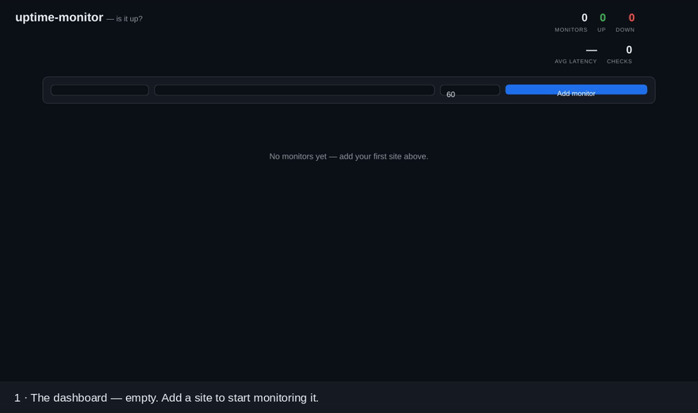

# Demo



*17 seconds — also available as [demo.mp4](demo.mp4). Captured from a
live local run of the real app: every card, status pill, latency and
sparkline below is the dashboard rendering live API data.*

## What the recording shows

1. **Empty dashboard.** The service is running (API + worker), no
   monitors yet — header stats all zero.
2. **Two monitors added** (via the API, interval 10 s):
   - **Demo Shop** — a tiny local website (`http://127.0.0.1:8899`):
     comes up **UP**, ~60 ms latency, uptime 100 %.
   - **Dead example** — `http://127.0.0.1:9`, a port where nothing
     listens: **DOWN** from the first check, error shown on the card.
3. **History builds up.** The worker keeps checking every interval;
   check counts grow and the latency sparklines fill in.
4. **A real outage.** The Demo Shop web server is stopped. Within one
   check interval the card flips to **DOWN**, the header reads
   0 up / 2 down, and the uptime drops (83 % at that moment).
5. **Recovery.** The site is started again; the next check flips the
   card back to **UP** — and the outage remains visible as the red dip
   in the sparkline and the sub-100 % uptime.

Local stand-in sites are used so the outage happens on cue and the
recording is reproducible anywhere. On a normal network the same flow
works with real sites — `python scripts/run_demo_seed.py` registers
github.com and tu-dortmund.de (both expected UP) plus the dead example.

## Reproduce it interactively

```bash
python -m venv .venv && source .venv/bin/activate
pip install -r requirements.txt

uvicorn app.main:app --port 8000     # terminal 1
python -m app.worker                 # terminal 2
python scripts/run_demo_seed.py      # terminal 3 (optional seed)
# dashboard -> http://localhost:8000
```

Add your own sites in the dashboard form, use **Check now** for an
on-demand probe, and stop one of your sites to watch it go red.
